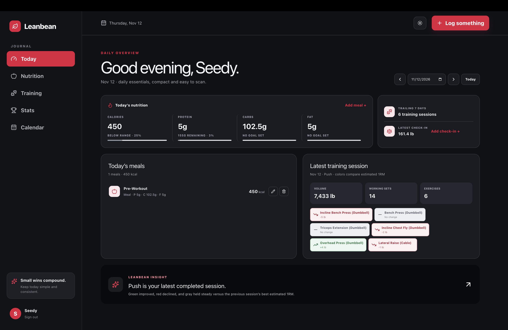
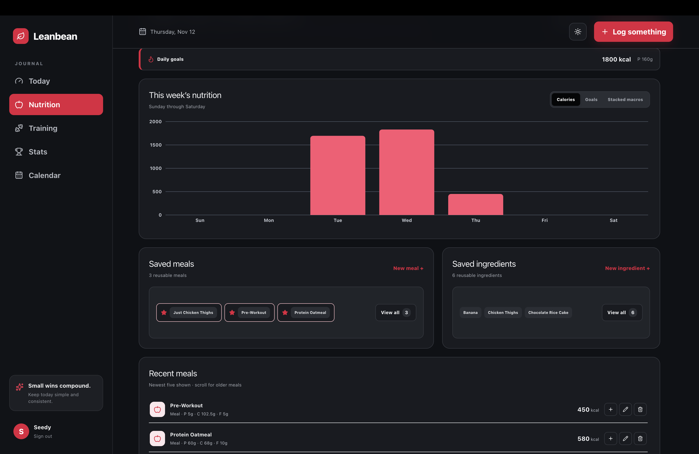
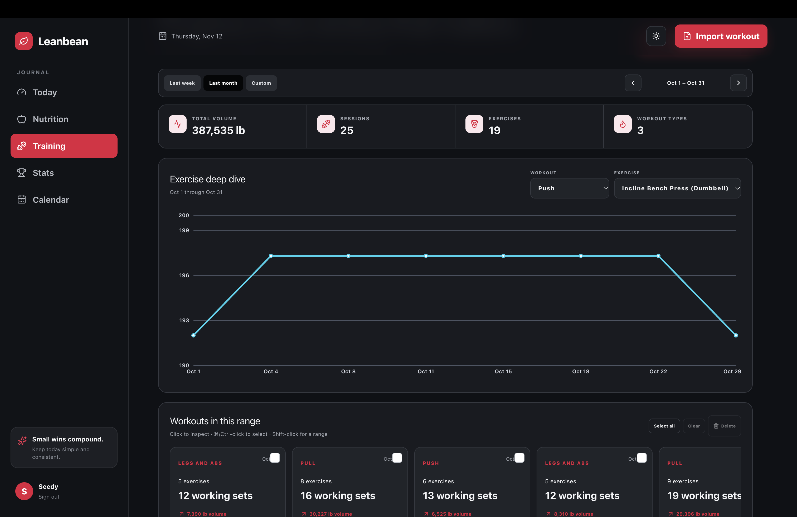
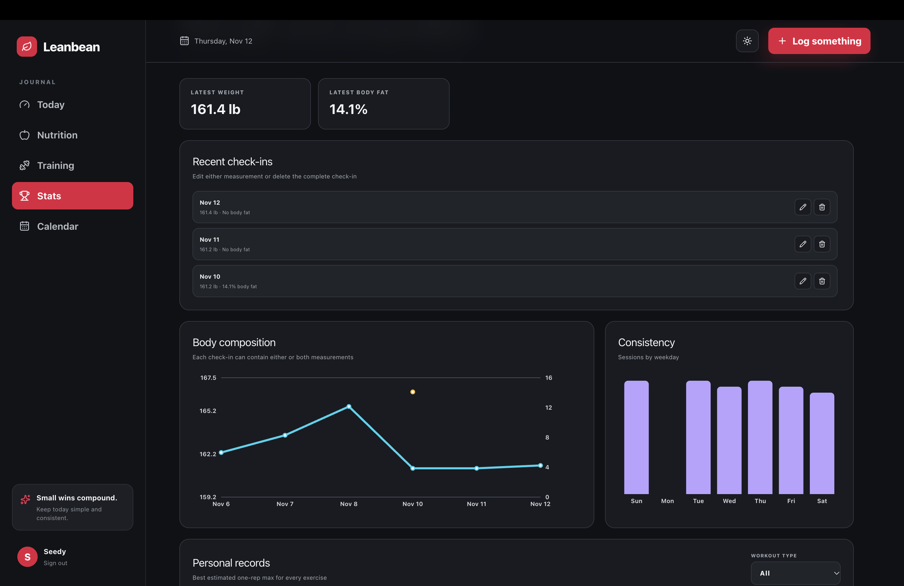
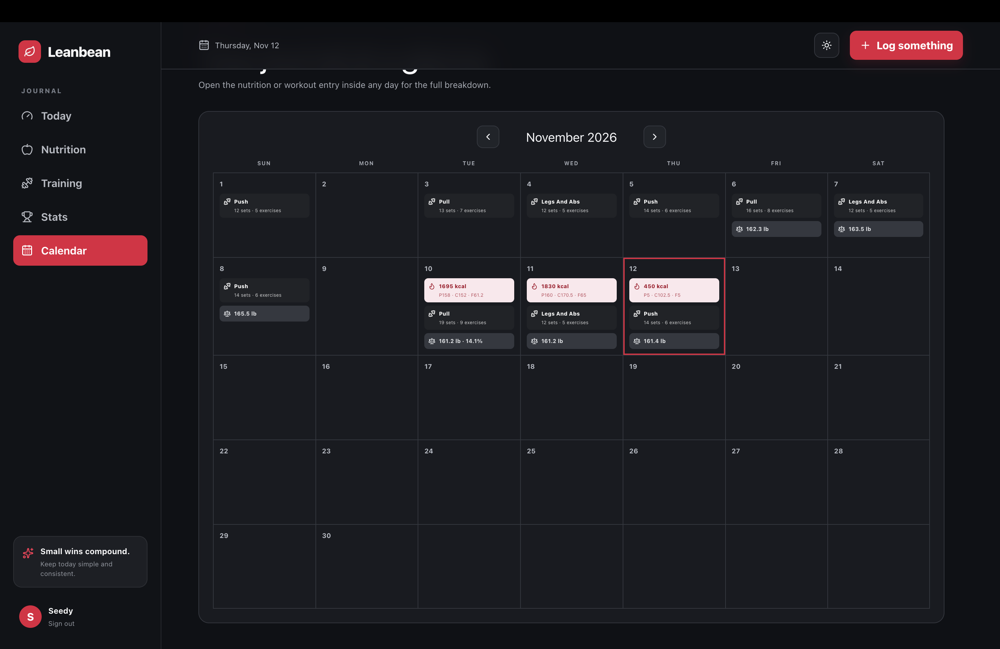

# Leanbean

Leanbean is a private nutrition and strength-training journal built as a ChatGPT Site. It combines daily nutrition, complete workout sessions, body-composition check-ins, and progress analysis in one dark, focused interface.

The active application lives in [`site/`](site/). 

<p align="center">
  <a href="./docs/screenshots/today.png">
    
  </a>
</p>

_The daily dashboard keeps nutrition targets, check-ins, and the latest training signals visible without a dense card grid._

## Feature gallery

The gallery is intentionally wider than the README. Scroll horizontally to browse every view, or click a screenshot to open the full-resolution image.

<table>
  <thead>
    <tr>
      <th>Today</th>
      <th>Nutrition</th>
      <th>Training</th>
      <th>Stats</th>
      <th>Calendar</th>
    </tr>
  </thead>
  <tbody>
    <tr>
      <td><a href="./docs/screenshots/today.png"></a></td>
      <td><a href="./docs/screenshots/nutrition.png"></a></td>
      <td><a href="./docs/screenshots/training.png"></a></td>
      <td><a href="./docs/screenshots/stats.png"></a></td>
      <td><a href="./docs/screenshots/calendar.png"></a></td>
    </tr>
  </tbody>
</table>

## What Leanbean does

### Daily overview

- Move backward or forward one day at a time, or jump directly to a date.
- See calories and every configured macro without opening another page.
- Get immediate visual feedback when calorie and macro goals are met.
- Review the latest workout with color-coded estimated 1RM changes.
- Log meals and body-composition check-ins directly from the daily view.

### Nutrition

- Set a required calorie goal and optional protein, carbohydrate, and fat goals.
- Build meals from ingredients with serving sizes and quantities.
- Save reusable ingredients and meals, with favorites kept immediately available.
- Reuse any recent meal for today, save it as a uniquely named variation, or overwrite its matching saved definition.
- Keep the five newest meals visible and scroll through the complete recent-meal history.
- Compare the current week using calories, goal progress, or stacked macros.

### Training

- Import complete workout sessions from Strong-style text exports.
- Browse weekly, monthly, or custom date ranges.
- Inspect, select, edit, and delete complete sessions rather than individual sets.
- Filter exercise analysis by workout type and exercise.
- Track the best estimated 1RM for each exercise and date with a focused Y-axis that makes smaller changes visible.
- Compare a selected session against its two predecessors in strict chronological order.

### Stats and calendar

- Record body weight, body-fat percentage, or both in a check-in.
- Edit and delete previous check-ins.
- Review body-composition trends, training consistency, and filtered personal records.
- Open daily workout and nutrition summaries from the calendar.
- Compare workout sets using reps for bodyweight exercises and estimated 1RM for weighted exercises.

### Light and dark themes

Leanbean defaults to its high-contrast dark interface and includes a header control for switching to a light workspace when preferred.

## Data and privacy

Each signed-in user sees only their own records. During local development, the Sites runtime supplies a test user and stores data under `site/.wrangler/`. That directory is ignored by Git and should never be committed.

The public repository contains application source and migrations only—no local nutrition, workout, check-in, or authentication data.

---

## Setup and development

### Requirements

- macOS or Linux
- Node.js 22.13 or newer
- npm
- `nvm` is recommended because the repository includes an `.nvmrc`

### 1. Select the supported Node version

From the repository root:

```bash
cd <repo-directory>
nvm install
nvm use
node --version
```

The reported version must be `v22.13.0` or newer. Node 20 cannot run the version of Vinext used by this project.

### 2. Install dependencies

```bash
cd <repo-directory>/site
npm ci
```

Use `npm ci` for a clean, reproducible installation from `package-lock.json`.

### 3. Initialize a brand-new local database

Skip this section when `site/.wrangler/` already contains your local data. Replaying every migration against an existing database can fail or alter data unexpectedly.

For a new database only:

```bash
cd <repo-directory>/site
npm run build

for migration in drizzle/*.sql; do
  node --import ./scripts/sites-env.mjs \
    ./node_modules/wrangler/bin/wrangler.js d1 execute DB \
    --local \
    --config dist/server/wrangler.json \
    --persist-to .wrangler/state \
    --file "$migration"
done
```

### 4. Run Leanbean on the custom local port

```bash
cd <repo-directory>/site
nvm use
npm run dev -- --port 8011
```

Open:

<http://127.0.0.1:8011/signin-with-chatgpt?return_to=/>

The local Sites runtime provides a development-only test sign-in. Leave the terminal running while using the app.

### Stop or restart the server

When the server is attached to the current terminal, press `Ctrl-C`.

If the terminal was closed or the process became detached, identify the listener:

```bash
lsof -nP -iTCP:8011 -sTCP:LISTEN
```

Then stop only the process using Leanbean's port:

```bash
kill "$(lsof -tiTCP:8011 -sTCP:LISTEN)"
```

Start it again with:

```bash
cd <repo-directory>/site
nvm use
npm run dev -- --port 8011
```

### Local data and backups

Local D1 state is stored in:

```text
site/.wrangler/state/
```

To make a local backup while the server is stopped:

```bash
cd <repo-directory>/site
cp -R .wrangler/state "../../leanbean-local-backup-$(date +%Y%m%d-%H%M%S)"
```

Keep backups outside the repository or add their destination to `.gitignore` before committing.

### Production-style local build

```bash
cd <repo-directory>/site
nvm use
npm run build
npm start -- --port 8011
```

The built Worker preview does not simulate ChatGPT sign-in, so `npm run dev` is the normal local workflow.

### Validation

Run both checks before committing application changes:

```bash
cd <repo-directory>/site
nvm use
npm run lint
npm run build
```

### Repository layout

```text
leanbean/
├── docs/screenshots/       README images
├── site/app/               UI and API routes
├── site/db/                Drizzle schema
├── site/drizzle/           D1 migrations
├── site/scripts/           local Sites/Vinext helpers
├── site/.openai/           hosting manifest
├── .gitignore
├── .nvmrc
└── README.md
```

### Common problems

**`node:fs/promises` does not provide an export named `glob`**

The terminal is using Node 20. Run `nvm use` and confirm `node --version` reports Node 22.13 or newer.

**The browser hangs or reports another Vinext server is running**

Find the process listening on port `8011`, stop that exact PID, and start the development server again using the commands above.

**The API says `Sign in required` locally**

Open the local sign-in URL instead of navigating directly to `/api/entries` or `/` in a fresh browser session.

**Local data appears missing**

Confirm the app was launched from `site/` and that `site/.wrangler/state/` still exists. Different persistence paths create separate local databases.
